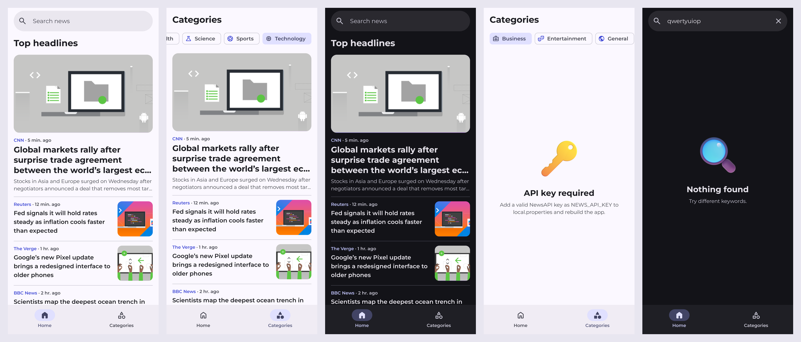

# News

Test task: a small news app on top of [NewsAPI](https://newsapi.org/).

Two screens:
- **Home**: top headlines plus search
- **Categories**: headlines filtered by category

Both lists are paginated. Pages are cached in Room, so the app works offline with whatever it loaded last.



## How to run

Get a free key at https://newsapi.org/register and add it to `local.properties`:

```
NEWS_API_KEY=your_key
```

Then run it from Android Studio, or use `./gradlew assembleDebug`.

## Stack

Kotlin, Compose (Material 3), Navigation Compose, Hilt, Coroutines/Flow, Paging 3 + RemoteMediator, Room, Retrofit + kotlinx.serialization, Coil.

Structure is simple MVVM: `ui` → `domain` (repository interface) → `data` (Retrofit, Room, RemoteMediator).

## Notes

- Search uses `/v2/everything`. Home and categories use `/v2/top-headlines` for the US.
- The free plan allows only 100 requests a day. Because of that, search waits a bit after typing and a loaded list is reused for 30 minutes.
- The free plan also returns at most 100 results per query. The list just ends there.
- Articles marked `[Removed]` are skipped.

Font: Montserrat (OFL). Icons: Material Symbols (Apache 2.0). Illustrations: Microsoft Fluent Emoji (MIT). Licenses are in `third-party-licenses/`.
